# Validation report

This report records what the proof battery proves: the Monte Carlo engine reproduces independent closed forms, textbook values, deterministic limits and economic monotonicity properties on notes extracted from the filings. Inputs are illustrative assumptions for testing the engine, not a valuation and not calibrated to any bank estimate; any bank estimated value shown is a comparison point only. Generated by scripts/validation_report.py at 2026-10-27.

## Summary

| Note | Maths | Quotes |
| --- | --- | --- |
| jpm_424b2-38582 | Maths 13/13 pass | Quotes 77/78, 1 field needs user confirmation |
| jpm_424b2-ea0309017 | Maths 14/14 pass | Quotes 74/74 verified |
| jpm_424b2-ea0308498 | Maths 12/12 pass | Quotes 71/73, 2 fields need user confirmation |
| jpm_424b2-ea0306095 | Maths 6/6 pass | Quotes 38/38 verified |

## jpm_424b2-38582

Issuer: JPMorgan Chase Financial Company LLC. Underlyings (2): Russell 2000® Index, S&P 500® Index. Features: autocall on 17 dates (trigger 1.0); no coupon; no upside; downside kind barrier level 0.7 observation final_only gearing 1.0. Pricing date: 2025-11-25; maturity date: 2030-11-29; preliminary: True. bank's estimated value: $954.00 (comparison only).

Illustrative market inputs as of 2025-11-25: risk-free rate 0.037, credit spread 0.006, vols (0.24, 0.17), dividend yields (0.012, 0.013), correlation [1.00, 0.60; 0.60, 1.00]. Source: illustrative inputs for the proof battery, not market data.

| Check | Result | Engine | Reference | Tolerance | What was compared |
| --- | --- | --- | --- | --- | --- |
| bsm_known_values | PASS | 4.76 | 4.76 | 0.0050 | BSM call and put at S=42, K=40, r=0.10, sigma=0.20, T=0.5 compared with 4.76 and 0.81 |
| put_call_parity | PASS | 3.33 | 3.33 | 0.0000 | C - P compared with S e^{-qT} - K e^{-rT} at S=42, K=40, r=0.10, sigma=0.20, T=0.5, q=0.03 |
| determinism | PASS | 907.72 | 907.72 | 0.0000 | price_note run twice with seed=0, n_paths=100000; prices must be identical |
| barrier_removed | PASS | 672.69 | 673.04 | 1.02 | single asset, autocall/coupon/upside removed, BUFFER level 1.0 gearing 1.0; MC vs N*min(W,1) closed form |
| barrier_at_maturity | PASS | 703.72 | 704.03 | 1.37 | single asset, autocall/coupon/upside removed, BARRIER at downside level FINAL_ONLY gearing 1; MC vs put + digital closed form |
| never_callable | PASS | 703.90 | 704.03 | 1.37 | single asset; autocall trigger set to 1e6 (never reached); upside removed; downside set to BARRIER at the term-sheet level, FINAL_ONLY, gearing 1; MC vs barrier closed form plus digital coupons |
| zero_coupon_no_downside | PASS | 806.07 | 806.07 | 0.0010 | single asset, autocall/coupon/upside removed, BARRIER level 1e-6 (never breached); MC vs N*DF(T_p) |
| zero_vol | PASS | 282.12 | 282.12 | 0.0010 | single asset, vol 1e-8, autocall/coupon/upside removed, BARRIER at downside level gearing 1; q=r+0.10 (above barrier, if applicable) and q set for W=K/2 (below barrier) |
| correlation_one | PASS | 952.78 | 953.70 | 3.06 | underlying 0 duplicated into two identical assets with correlation [[1,1],[1,1]], all features kept; compared with the N=1 note |
| correlation_monotonicity | PASS | 943.61 | 866.47 | 1.46 | uniform off-diagonal rho in (0.0, 0.25, 0.5, 0.75, 0.95), same seed (common random numbers); each price must be >= previous - 2 SE |
| vol_monotonicity | PASS | 870.32 | 947.12 | 1.60 | all vols scaled by (0.8, 1.0, 1.2), same seed; each price must be <= previous + 2 SE (short-put note) |
| spread_monotonicity | PASS | 887.12 | 907.72 | 0.0000 | credit spread + (0, 0.005, 0.01), same seed; prices must be strictly decreasing |
| convergence | PASS | 0.4974 | 0.5000 | 0.1000 | barrier_at_maturity setup at n_paths//16, n_paths//4, n_paths; each price within 3 SE of closed form and each SE ratio in [0.4, 0.6] |
| quotes | NEEDS CONFIRMATION | 77.00 | 78.00 | 0.0000 | 77/78 verified |

Unverified fields are flagged to the user, not a pricing failure. Unverified:

- downside.gearing

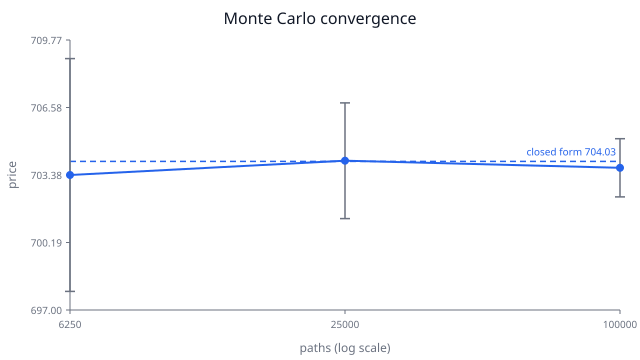

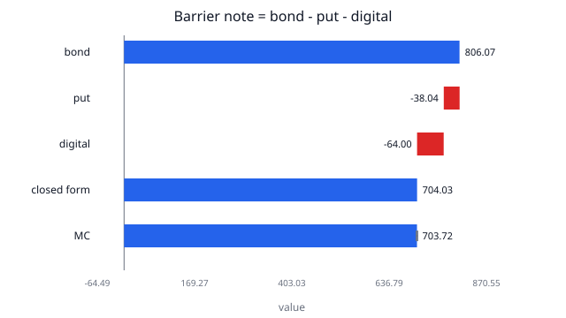

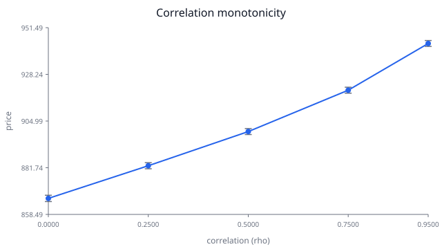

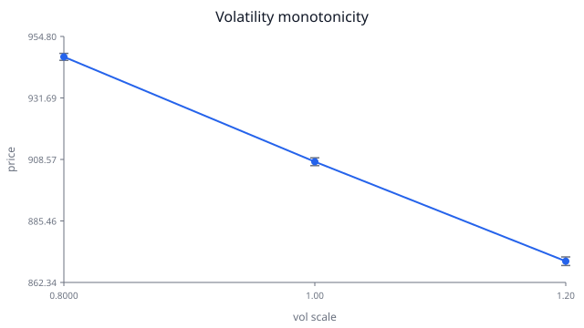

## jpm_424b2-ea0309017

Issuer: JPMorgan Chase Financial Company LLC. Underlyings (3): S&P 500® Index, Russell 2000® Index, Nasdaq-100 Index®. Features: autocall on 7 dates (trigger 1.0); coupon amount 9.1667 with memory=False (barrier 0.825, 9 observations); no upside; downside kind buffer level 0.825 observation final_only gearing 1.21212. Pricing date: 2026-10-15; maturity date: 2027-07-19; preliminary: False. bank's estimated value: $993.20 (comparison only).

Illustrative market inputs as of 2026-10-15: risk-free rate 0.037, credit spread 0.006, vols (0.17, 0.24, 0.21), dividend yields (0.013, 0.012, 0.007), correlation [1.00, 0.80, 0.90; 0.80, 1.00, 0.75; 0.90, 0.75, 1.00]. Source: illustrative inputs for the proof battery, not market data.

| Check | Result | Engine | Reference | Tolerance | What was compared |
| --- | --- | --- | --- | --- | --- |
| bsm_known_values | PASS | 4.76 | 4.76 | 0.0050 | BSM call and put at S=42, K=40, r=0.10, sigma=0.20, T=0.5 compared with 4.76 and 0.81 |
| put_call_parity | PASS | 3.33 | 3.33 | 0.0000 | C - P compared with S e^{-qT} - K e^{-rT} at S=42, K=40, r=0.10, sigma=0.20, T=0.5, q=0.03 |
| determinism | PASS | 1000.25 | 1000.25 | 0.0000 | price_note run twice with seed=0, n_paths=100000; prices must be identical |
| barrier_removed | PASS | 918.94 | 919.08 | 0.4932 | single asset, autocall/coupon/upside removed, BUFFER level 1.0 gearing 1.0; MC vs N*min(W,1) closed form |
| barrier_at_maturity | PASS | 948.86 | 948.72 | 0.5722 | single asset, autocall/coupon/upside removed, BARRIER at downside level FINAL_ONLY gearing 1; MC vs put + digital closed form |
| never_callable | PASS | 1026.59 | 1026.61 | 0.6468 | single asset; autocall trigger set to 1e6 (never reached); coupon memory set to False; upside removed; downside set to BARRIER at the term-sheet level, FINAL_ONLY, gearing 1; MC vs barrier closed form plus digital coupons |
| zero_coupon_no_downside | PASS | 967.89 | 967.89 | 0.0010 | single asset, autocall/coupon/upside removed, BARRIER level 1e-6 (never breached); MC vs N*DF(T_p) |
| zero_vol | PASS | 399.26 | 399.26 | 0.0010 | single asset, vol 1e-8, autocall/coupon/upside removed, BARRIER at downside level gearing 1; q=r+0.10 (above barrier, if applicable) and q set for W=K/2 (below barrier) |
| correlation_one | PASS | 1016.08 | 1016.00 | 0.3622 | underlying 0 duplicated into two identical assets with correlation [[1,1],[1,1]], all features kept; compared with the N=1 note |
| correlation_monotonicity | PASS | 1002.96 | 995.21 | 0.3467 | uniform off-diagonal rho in (0.0, 0.25, 0.5, 0.75, 0.95), same seed (common random numbers); each price must be >= previous - 2 SE |
| vol_monotonicity | PASS | 984.90 | 1013.72 | 0.4885 | all vols scaled by (0.8, 1.0, 1.2), same seed; each price must be <= previous + 2 SE (short-put note) |
| spread_monotonicity | PASS | 995.88 | 1000.25 | 0.0000 | credit spread + (0, 0.005, 0.01), same seed; prices must be strictly decreasing |
| coupon_monotonicity | PASS | 1019.68 | 1000.25 | 0.0000 | coupon amount x (1.0, 1.5), same seed; prices must be strictly increasing |
| convergence | PASS | 0.5050 | 0.5000 | 0.1000 | barrier_at_maturity setup at n_paths//16, n_paths//4, n_paths; each price within 3 SE of closed form and each SE ratio in [0.4, 0.6] |
| quotes | PASS | 74.00 | 74.00 | 0.0000 | 74/74 verified |

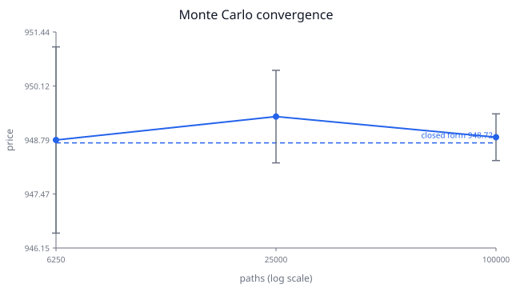

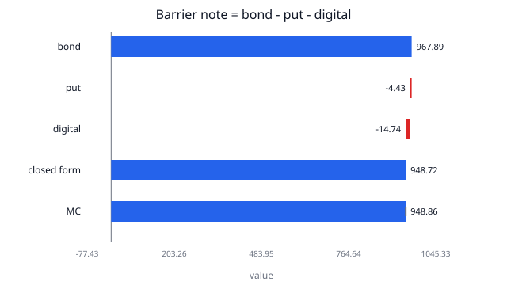

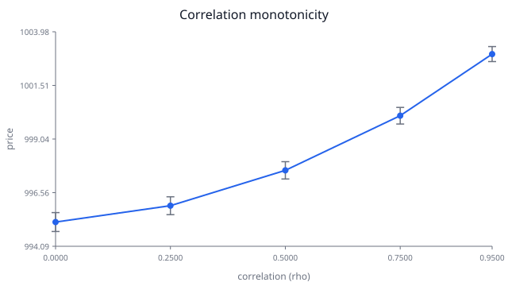

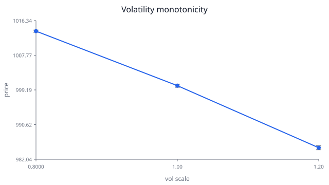

## jpm_424b2-ea0308498

Issuer: JPMorgan Chase Financial Company LLC. Underlyings (1): Expand Energy Corporation. Features: autocall on 7 dates (trigger 1.0); coupon amount 8.4583 with memory=False (barrier 0.72, 13 observations); no upside; downside kind barrier level 0.72 observation final_only gearing 1.0. Pricing date: 2026-10-09; maturity date: 2027-11-15; preliminary: False. bank's estimated value: $959.80 (comparison only).

Illustrative market inputs as of 2026-10-09: risk-free rate 0.037, credit spread 0.006, vols (0.35,), dividend yields (0.01,), correlation [1.00]. Source: illustrative inputs for the proof battery, not market data.

| Check | Result | Engine | Reference | Tolerance | What was compared |
| --- | --- | --- | --- | --- | --- |
| bsm_known_values | PASS | 4.76 | 4.76 | 0.0050 | BSM call and put at S=42, K=40, r=0.10, sigma=0.20, T=0.5 compared with 4.76 and 0.81 |
| put_call_parity | PASS | 3.33 | 3.33 | 0.0000 | C - P compared with S e^{-qT} - K e^{-rT} at S=42, K=40, r=0.10, sigma=0.20, T=0.5, q=0.03 |
| determinism | PASS | 958.87 | 958.87 | 0.0000 | price_note run twice with seed=0, n_paths=100000; prices must be identical |
| barrier_removed | PASS | 827.22 | 827.48 | 0.9232 | single asset, autocall/coupon/upside removed, BUFFER level 1.0 gearing 1.0; MC vs N*min(W,1) closed form |
| barrier_at_maturity | PASS | 871.34 | 871.54 | 1.34 | single asset, autocall/coupon/upside removed, BARRIER at downside level FINAL_ONLY gearing 1; MC vs put + digital closed form |
| never_callable | PASS | 967.01 | 966.51 | 1.48 | single asset; autocall trigger set to 1e6 (never reached); coupon memory set to False; upside removed; downside set to BARRIER at the term-sheet level, FINAL_ONLY, gearing 1; MC vs barrier closed form plus digital coupons |
| zero_coupon_no_downside | PASS | 953.75 | 953.75 | 0.0010 | single asset, autocall/coupon/upside removed, BARRIER level 1e-6 (never breached); MC vs N*DF(T_p) |
| zero_vol | PASS | 343.35 | 343.35 | 0.0010 | single asset, vol 1e-8, autocall/coupon/upside removed, BARRIER at downside level gearing 1; q=r+0.10 (above barrier, if applicable) and q set for W=K/2 (below barrier) |
| vol_monotonicity | PASS | 929.10 | 989.69 | 1.10 | all vols scaled by (0.8, 1.0, 1.2), same seed; each price must be <= previous + 2 SE (short-put note) |
| spread_monotonicity | PASS | 952.14 | 958.87 | 0.0000 | credit spread + (0, 0.005, 0.01), same seed; prices must be strictly decreasing |
| coupon_monotonicity | PASS | 989.96 | 958.87 | 0.0000 | coupon amount x (1.0, 1.5), same seed; prices must be strictly increasing |
| convergence | PASS | 0.4980 | 0.5000 | 0.1000 | barrier_at_maturity setup at n_paths//16, n_paths//4, n_paths; each price within 3 SE of closed form and each SE ratio in [0.4, 0.6] |
| quotes | NEEDS CONFIRMATION | 71.00 | 73.00 | 0.0000 | 71/73 verified |

Unverified fields are flagged to the user, not a pricing failure. Unverified:

- dependency
- downside.gearing

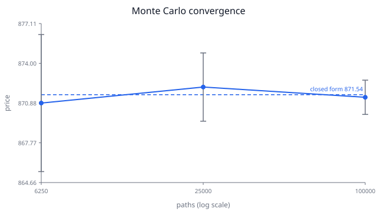

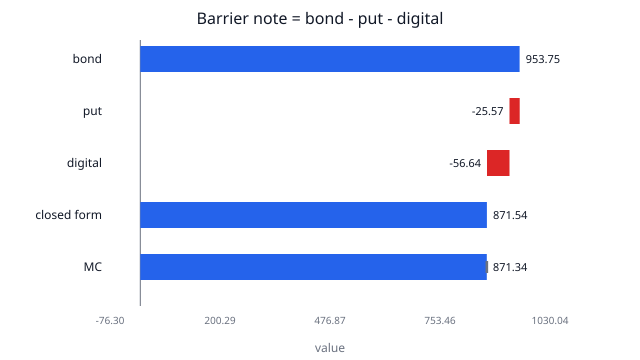

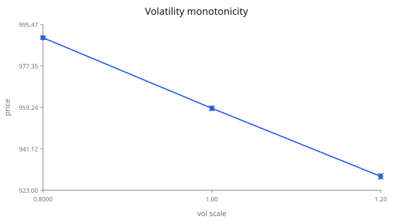

## jpm_424b2-ea0306095

Issuer: JPMorgan Chase Financial Company LLC. Underlyings (3): Common stock of Amazon.com, Inc., par value $0.01 per share, Common stock of Tractor Supply Company, par value $0.008 per share, Common stock of Oracle Corporation, par value $0.01 per share. Features: autocall on 1 dates (trigger 1.0); no coupon; upside leverage 2.0 cap None; downside kind buffer level 0.6 observation final_only gearing 1.0. Pricing date: 2026-09-17; maturity date: 2028-09-21; preliminary: False. bank's estimated value: $980.00 (comparison only). Priced with the registered agent-written payoff synthesized_46661pwm5, which passed the synthesized-payoff proof battery in the registry.

Illustrative market inputs as of 2026-09-17: risk-free rate 0.037, credit spread 0.006, vols (0.3, 0.35, 0.28), dividend yields (0.0, 0.01, 0.012), correlation [1.00, 0.50, 0.50; 0.50, 1.00, 0.50; 0.50, 0.50, 1.00]. Source: illustrative inputs for the proof battery, not market data.

| Check | Result | Engine | Reference | Tolerance | What was compared |
| --- | --- | --- | --- | --- | --- |
| static_safety | PASS | 1.00 | 1.00 | 0.0000 | sandbox static check passed |
| determinism | PASS | 0.0000 | 0.0000 | 0.0000 | payoff run twice on the same simulated perf (seed=0, n_paths=20000); arrays must be identical |
| output_sanity | PASS | 0.0000 | 0.0000 | 0.0000 | shape (20000, 2), finite, cash >= 0, zero after trusted call date (seed=0, n_paths=20000) |
| filing_examples | PASS | 0.0000 | 0.0000 | 0.0100 | 20 verified filing examples; cash at the final column must equal the cited payment within $0.01 and other columns must be 0 |
| called_paths_match_template | PASS | 0.0000 | 0.0000 | 0.0000 | 4615 called paths (seed=0, n_paths=20000); generated row sums must equal trusted template undiscounted totals within 1e-9 * notional and columns after the call must be zero |
| convergence | PASS | 0.5076 | 0.5000 | 0.1000 | price_cashflows at paths (1250, 5000, 20000) (seed=0); SE ratios must lie in [0.4, 0.6] and consecutive prices within 3 combined SE |
| quotes | PASS | 38.00 | 38.00 | 0.0000 | 38/38 verified |

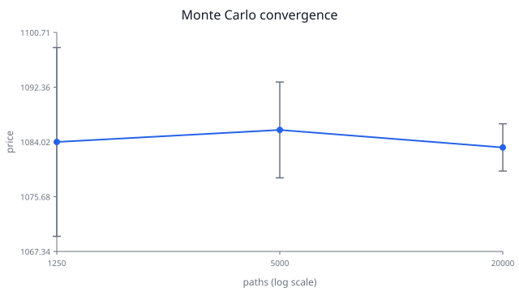

## Checks

- **bsm_known_values**: a call is the present value of receiving the stock when it ends above the strike minus paying the strike in those states; the put mirrors it.
- **put_call_parity**: a call minus a put pays ``S_T - K`` in every state, exactly like holding the (dividend-adjusted) stock and owing discounted cash ``K``.
- **determinism**: a fixed seed fixes every random draw, so a reported price can always be recomputed by a reviewer.
- **barrier_removed**: with the buffer at 100% the investor gives up every gain and bears every loss from the first cent, i.e. is short an at-the-money put.
- **barrier_at_maturity**: principal is repaid unless the asset ends below the barrier, in which case the investor loses ``1 - W``: a put plus a digital for the gap.
- **never_callable**: a trigger of 1e6 can never be reached, so the note certainly survives to maturity and every coupon is an independent digital bet.
- **zero_coupon_no_downside**: with no coupon, no upside and no realistic downside, all that remains is repayment of principal, discounted with the issuer's spread.
- **zero_vol**: with no randomness there is nothing to simulate; the engine must reproduce the single deterministic path in both states of the world.
- **correlation_one**: the worst of two identical performances is that performance, so adding a perfect copy cannot change the payoff on any path.
- **correlation_monotonicity**: higher correlation makes the underlyings fall together, so the worst of them is less likely to be far below the others; a short worst-of downside position is therefore worth more.
- **vol_monotonicity**: with no upside leg the note is short downside optionality, so more volatility raises the value of what the investor has sold.
- **spread_monotonicity**: the note is the issuer's unsecured debt; a wider spread is a bigger discount on every promised payment.
- **convergence**: the standard error of a Monte Carlo mean falls with the square root of the number of paths; this checks the reported SE is honest.
- **quotes**: a number without a quote that can be found in the filing cannot be trusted or shown to a user silently (project rule 5a).
- **coupon_monotonicity**: the investor is long the coupon leg; paying 1.5x on the same paths pays more on every path that pays at all.
- **static_safety**: Generated code is untrusted; anything the static checker cannot see through is refused without execution.
- **output_sanity**: A note cannot pay a negative amount, and once it has been called it no longer exists, so nothing may be paid afterwards.
- **filing_examples**: The filing's own hypothetical payment table is ground truth; a payoff that cannot reproduce it to the cent has misread the terms.
- **called_paths_match_template**: The new feature changes the maturity payoff only; called paths never reach maturity, so the trusted template is an exact reference there.
